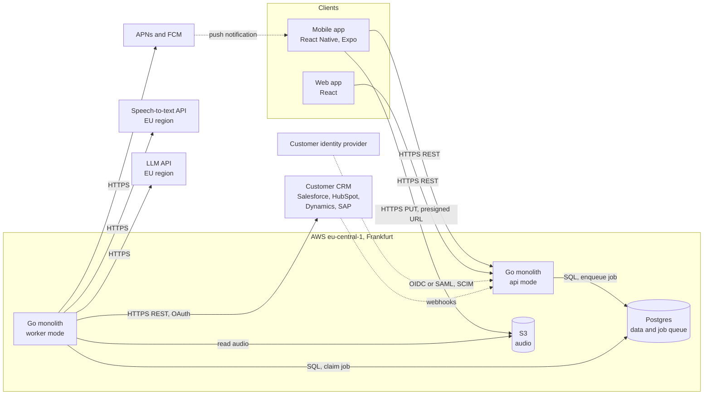

# Part 1: How I would build VoiceLine from scratch

Part 2 (the Go service in this repo) is a small working slice of this design, mapped [near the end](#how-part-2-maps-to-this-design).

## Scope and stance

I design the core loop first. After a customer visit, a field-sales rep records a voice note ("note"). The system drafts a visit report ("report"). The rep approves the report, and a worker writes it to the CRM. Pre-visit briefings, meeting recording and the manager views read from this loop or feed it.

Three constraints decide every choice below.

1. **The team is about five engineers.** One deployable backend and managed services remove the need for a platform team.
2. **The customers are European industrial companies.** Customer data stays in the EU, and the design must pass an enterprise security review.
3. **A wrong CRM record costs more than a late one.** Reps trust the product only while the CRM stays correct. So the AI output is a draft until a person or a tenant rule approves it.

## Building blocks

| Block | Tech | Why |
|---|---|---|
| Mobile app | React Native with Expo, TypeScript | EAS Update ships JavaScript fixes without a store review. |
| Web app | React, TypeScript, Vite | Managers and admins use it. It shares the generated API client with the mobile app. |
| Backend | Go modular monolith, REST and JSON described by an OpenAPI file | Hard module boundaries let a module become a separate service later. |
| Database | Postgres (AWS RDS, Multi-AZ) | The business data and the job queue share one database, so one transaction and one backup cover both. |
| Audio storage | S3, with presigned upload URLs | Audio never passes through the API servers. |
| Async work | Postgres job queue (`FOR UPDATE SKIP LOCKED`), Go worker pool | The queue needs no extra system to run. |
| AI | Speech-to-text and LLM behind Go interfaces, both in the EU. | Models change every few months. A provider swap is a small change that evals check. |
| CRM layer | One adapter per CRM behind one Go interface | CRMs differ in auth, API limits and data model. Only the adapter sees these differences. |
| Infra | AWS Frankfurt (`eu-central-1`), ECS Fargate, Terraform, GitHub Actions | Customer audio and CRM data stay in the EU under GDPR. Frankfurt is close to sales teams in Germany, and Amazon Bedrock runs there. |

## How the blocks talk

### One note, end to end

| # | Step | Sync or async | Protocol |
|---|---|---|---|
| 1 | The rep records a note. The app saves the audio and a phone-made UUID in a local SQLite queue. No network is needed. | Local | None |
| 2 | When the phone is online, the app registers the note, with the UUID as the idempotency key. The API returns a presigned upload URL. | Sync | HTTPS REST |
| 3 | The app uploads the audio to S3 in an OS background session. The upload continues while the app is in the background. If the upload stops, the app starts it again at the next launch. | Sync, direct to S3 | HTTPS PUT |
| 4 | The app confirms the upload. In one transaction, the API marks the note uploaded and inserts a `transcribe` job. The API returns HTTP 202. | Sync | HTTPS REST |
| 5 | A worker claims the job, transcribes the audio, saves the transcript and inserts an `extract` job. | Async | Postgres queue, HTTPS |
| 6 | A worker sends the transcript, the tenant's report schema and candidate CRM accounts to the LLM. The worker validates the output and saves a draft report. | Async | Postgres queue, HTTPS |
| 7 | A worker sends a push notification. The app fetches the draft report. | Async, then sync | APNs or FCM, HTTPS REST |
| 8 | The rep fixes any wrong field and approves. In one transaction, the API saves the approval, writes an audit row and inserts a `crm_write` job. | Sync | HTTPS REST |
| 9 | A worker upserts the report into the CRM, keyed by the note ID. A retry updates the same CRM record. | Async | Postgres queue, HTTPS REST with OAuth |
| 10 | The note shows "Synced" with a link to the CRM record. If the last retry fails, the note shows "Failed" with the reason and a retry button. | Sync | HTTPS REST |

Each stage saves its output before the next one starts. So a retry of step 9 never repeats the paid calls in steps 5 and 6. If the confirm call in step 4 is lost, a periodic job finds the uploaded audio and repairs the note.

## Mobile app

- **Offline first.** Reps work in plants and on country roads, so recording never needs the network. The local queue holds the note until the API confirms the upload.
- **Upload method by size.** The app uploads a 2-minute note (about 0.5 MB) with one presigned PUT. For an hour of meeting recording, the app uses S3 multipart upload, which resumes from the last part after a dropped connection.
- **Auth.** SSO and SCIM come from a vendor such as WorkOS. The app keeps tokens in the iOS Keychain or the Android Keystore. An expired token blocks upload, not recording.
- **Other channels.** A new channel uses the same two API calls as the mobile app: register the note (step 2), then confirm the upload (step 4). For a phone line, a telephony provider records the call, and a backend handler makes the two calls. An Outlook add-in makes the two calls itself.

## Backend

One Go binary runs as `api` or `worker`. Its modules are packages under `internal/`: `identity`, `note`, `job`, `ai`, `report`, `crm` and `insight`.

- A module calls another module only through its exported interface. Only the module that owns a table writes to that table. An import linter enforces the first rule, and code review enforces the second.
- Backend CI compares the OpenAPI file with `main` using `oasdiff` and fails a pull request with a breaking change. Old mobile app versions stay in use for weeks, so a breaking change needs a new API version. CI also publishes the generated TypeScript client as a versioned package, which the web and mobile repos install.
- Tenants share one database. Every row has a `tenant_id`. With row-level security, a query without a tenant returns no rows. S3 keys start with the tenant ID. An automated test tries to read another tenant's data on every endpoint.

## AI layer

- **Two interfaces.** `Transcriber` turns audio into text. `Extractor` turns text and a schema into a report. A saved transcript lets extraction run again without a second transcription cost.
- **Default LLM.** The default is a Claude model on Amazon Bedrock, called from Frankfurt through the EU inference profile. Bedrock can process an LLM call in any EU region of that profile, so the data stays in the EU but not always in Frankfurt. Bedrock keeps LLM calls in the same AWS account and contract as the rest of the system. Bedrock does not use the data for model training.
- **Speech-to-text by evals.** I would first compare Amazon Transcribe (same contract, custom vocabulary) with an EU-hosted specialist such as Speechmatics. Word error rate on real field audio decides. Public benchmarks do not contain German dialects, road noise or product names such as "DN 80 flange". Each tenant's vocabulary list (products, customers, competitors) goes to the `Transcriber` and the `Extractor` as hints. Self-hosted Whisper on GPU instances is the fallback if a customer forbids third-party model APIs, or when volume makes self-hosting cheaper.
- **No invented data.** The schema comes from the tenant's CRM field mapping and allows null for "not mentioned". Each field carries its source quote, which the review screen shows. Code drops a field whose quote is not in the transcript. The LLM picks CRM accounts only from the candidate list. Code resolves relative dates from the recording time.
- **Evals and budgets.** Every saved AI result records the prompt version, schema version and model. CI runs a golden set of field audio on every prompt, schema or model change. A model swap is then a pull request with an eval report. Each stage logs duration and cost per tenant. The starting target is a draft report within 60 seconds of upload for 95% of notes.
- **Auto-approve later.** A tenant can auto-approve report types that reps rarely edit before approval.

## CRM integration layer

Each adapter has four operations. It reads the field definitions, searches accounts and contacts, upserts a report and upserts a task.

- Field mapping is versioned tenant data that admins edit in the web app. A tenant with a custom Salesforce setup needs no deploy to onboard.
- The note ID is the external key for every upsert, so a retry updates the same CRM record. Salesforce keeps this key in an external ID field, Dynamics keeps it in an alternate key, and HubSpot keeps it in a unique property. Where an object cannot hold such a key, the worker searches for the note ID before it writes again. After a write, the worker stores the CRM record ID.
- Each adapter classifies errors as retryable (timeout, HTTP 429, HTTP 5xx) or permanent. Workers obey `Retry-After`. A per-tenant rate limiter protects the CRM's daily API quota.
- KMS encrypts the OAuth tokens. After a failed token refresh, the web app shows "Needs reconnect" to the admin. CRM webhooks and a periodic job keep a local account cache for matching and briefings.

## Infrastructure

- Dev, staging and production run in separate AWS accounts in `eu-central-1`. Terraform defines all of them. ECS Fargate runs `api` and `worker` from one image, and workers scale on queue depth.
- GitHub Actions runs tests, evals and the AI code review. It signs in to AWS with OIDC, so no long-lived keys exist. A production deploy needs one manual approval.
- Secrets Manager and KMS hold the secrets. Logs carry IDs, never audio or transcripts. OpenTelemetry traces follow the note ID. Alerts fire on the age of the oldest queued job and on the CRM write failure rate per tenant.

## Security and practices

- Audio, transcripts, reports and all model calls stay in the EU. Push notifications carry only a note ID, because APNs and FCM run outside the EU. KMS keys encrypt stored data. The subprocessor list names every vendor that handles customer data, AI providers included. A GDPR erasure request runs as a job in the same queue.
- In Germany, recording a person without consent is a criminal offence. So meeting recording needs an explicit consent step.
- The system deletes audio 30 days after sync by default. Each tenant can change this period.
- An `AGENTS.md` file gives coding agents the project rules. An AI code review checks each pull request before a human approves it.

## Key trade-offs

| Decision | Chosen | Alternative | Why |
|---|---|---|---|
| Service shape | Modular monolith | Microservices | Five engineers cannot run a dozen services well. Boundaries in code give most of the benefit. |
| Queue | Postgres | SQS, Kafka, RabbitMQ | The job commits in the same transaction as the note. The volume is thousands of notes per day, not per second. The team moves to SQS only when queue wait time or database CPU shows the need. |
| Compute | ECS Fargate | Kubernetes | Fargate has no cluster to patch. Kubernetes is worth its cost only with a platform team. |
| API | REST and OpenAPI | GraphQL, gRPC | REST serves two first-party clients with the least tooling. The generated TypeScript client gives the typed contract that teams often choose GraphQL for. |
| Tenancy | Shared schema with row-level security | Database per tenant | One migration and one connection pool serve all tenants. A dedicated database stays possible for a customer who pays for one. |
| CRM write | After human approval | Write at once | A wrong CRM record destroys trust. The edit rate also measures AI quality. |
| Extraction | One LLM call with a strict schema | Agent with tools | Cost and latency are predictable, and the output is easy to evaluate. Agents fit open tasks such as briefings. |
| Mobile | React Native with Expo | Native Swift and Kotlin | One codebase serves iOS and Android. Recording and background upload have maintained native modules. |
| SSO | Buy | Build | SAML and SCIM edge cases are not where this team should spend time. |

## How Part 2 maps to this design

| This design | In Part 2 |
|---|---|
| Upload returns HTTP 202, and the work happens later | `POST /v1/recordings` stores a job and returns HTTP 202. `GET /v1/recordings/{id}` returns the status. |
| Postgres queue with lease, backoff and max attempts | Hand-written `SKIP LOCKED` queue, with an integration test for concurrent claims and lease expiry |
| AI provider swap | `ai.Provider` with OpenAI and Gemini, chosen by `AI_PROVIDER` |
| CRM adapters | `worker.Sender` with a webhook adapter and a HubSpot adapter, chosen by `DESTINATION` |
| Idempotency | `Idempotency-Key` on upload. The service saves the AI result before delivery, so a delivery retry does not call the LLM again. |
| Model output validated at the boundary | Strict JSON schema and validation in Go. A provider failure is never a silent success. |
| Agent rules and AI code review | `AGENTS.md`, `REVIEW.md`, `.github/workflows/ai-review.yml` |

To keep the scope small, Part 2 leaves out auth, tenants, presigned S3 upload, human review and evals. The audio is in the job row. Part 2 also leaves out CRM OAuth, field mapping, contact matching and all infrastructure beyond Docker Compose. Transcription and extraction run in one job step, not as separate queue stages. The HubSpot adapter uses one static token. It finds the company by name, without regard to case, or creates the company, and attaches the HubSpot note to that company. The model resolves relative dates such as "next Tuesday" from the date of the analysis. Production code resolves these dates from the recording time. The CRM write is not idempotent, so a lost HubSpot response can create a second HubSpot note.

## Assumptions

- The stack stays Go, TypeScript, React and React Native, with about five engineers.
- Salesforce, HubSpot, Dynamics and SAP are the CRMs that matter most.
- Human review, the 60-second target and 30-day audio retention are starting choices. Customer feedback and measured numbers can change them.
