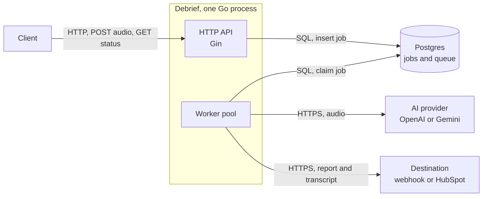

# Debrief

Debrief is my solution to the VoiceLine take-home. It is a Go service that turns the audio recording of a field-sales visit into a visit report. It sends the report to a webhook, or as a HubSpot note on the customer's company. My answer to Part 1, the architecture, is in [ARCHITECTURE.md](ARCHITECTURE.md). The design details of this service are in [docs/DESIGN.md](docs/DESIGN.md).

## Quick start

You need Docker Compose, `curl`, `jq`, an OpenAI or Gemini API key, and Go 1.26 for the tests.

1. Copy the example config.

   ```sh
   cp .env.example .env
   ```

2. In `.env`, set `OPENAI_API_KEY`. To use Gemini, set `AI_PROVIDER=gemini` and `GEMINI_API_KEY` instead.
3. Open [webhook.site](https://webhook.site) and copy the unique URL that the page shows. In `.env`, set `WEBHOOK_URL` to that URL.
4. Start the service. It is ready when the log shows `server started`.

   ```sh
   make run
   ```

## Send a recording

In a second terminal, go to the top folder of the repository, which contains `testdata/`. Then upload the sample recording.

```sh
id=$(curl -s -F audio=@testdata/visit-note.m4a http://localhost:8080/v1/recordings | jq -r .id)
```

In the same terminal, run this command until `status` is `succeeded` or `failed`. On success, the command output and the webhook.site page show the report. On failure, `last_error` gives the cause.

```sh
curl -s http://localhost:8080/v1/recordings/$id | jq .
```

To send the report to a CRM, for example HubSpot, set `DESTINATION=hubspot` and `HUBSPOT_TOKEN` in `.env`. For the token, refer to [Configuration](#configuration). Then stop the service, run `make run` again and upload the sample again. The report shows as a note on the timeline of the customer's company in HubSpot.

## Commands

| Command | What it does |
|---|---|
| `make run` | Builds the service and starts it with its database (Postgres) in Docker. |
| `make check` | Runs `go vet`, `golangci-lint`, the unit tests with `-race`, and `govulncheck`. |
| `make test-integration` | Starts the database (Postgres) on host port `5433`. Then runs all tests, including the job queue tests against a separate test database. The tests do not change the jobs of `make run`. |

## How it works



1. The API saves the upload as a `queued` job and returns the job ID at once.
2. A worker claims the job and sends the audio to the AI provider. The provider returns a transcript and a visit report.
3. The worker saves the result and sends the report to the destination. If a step fails, the job goes back to the queue with a delay. A permanent error, such as HTTP `401`, fails the job at once.

## Configuration

If a necessary value is missing, or a value has an incorrect format or is not allowed, the API stops at startup and lists each problem. The API does not test the keys at startup.

| Variable | Default | Description |
|---|---|---|
| `AI_PROVIDER` | `openai` | `openai` or `gemini`. |
| `OPENAI_API_KEY`, `GEMINI_API_KEY` | | The API key of the provider that `AI_PROVIDER` selects. |
| `OPENAI_TRANSCRIBE_MODEL` | `gpt-4o-transcribe` | The OpenAI model that converts the audio to text. Allowed: `gpt-4o-transcribe`, `gpt-transcribe`. |
| `OPENAI_REPORT_MODEL` | `gpt-6-luna` | The OpenAI model that writes the visit report. Allowed: `gpt-6-luna`, `gpt-5.6-luna`. |
| `GEMINI_MODEL` | `gemini-3.5-flash` | The Gemini model. Allowed: `gemini-3.5-flash`, `gemini-3.6-flash`. |
| `DESTINATION` | `webhook` | `webhook` or `hubspot`. |
| `WEBHOOK_URL` | | The URL that gets the job ID, the transcript and the report as a JSON `POST`. Necessary if `DESTINATION` is `webhook`. |
| `HUBSPOT_TOKEN` | | A HubSpot service key with the scopes `crm.objects.companies.read`, `crm.objects.companies.write` and `crm.objects.contacts.write`. To create it, in HubSpot go to **Development > Keys > Service keys**. Necessary if `DESTINATION` is `hubspot`. |
| `PORT` | `8080` | The HTTP port. Docker Compose also publishes the API on this port on your computer. |
| `WORKERS` | `4` | The number of workers in one instance. Each worker processes one job at a time. |
| `MAX_ATTEMPTS` | `5` | The maximum number of attempts for a job. The service saves this value in each job at upload, so a change applies to new jobs only. |
| `DATABASE_URL` | | The connection URL of the database. Docker Compose sets it. |
| `OPENAI_BASE_URL`, `GEMINI_BASE_URL` | vendor URL | Sends provider calls to a proxy or to a local test stub. |

If a model is overloaded or retired, set its setting to another allowed model.

## Trade-offs

- Debrief stores the audio in the database, not in [object storage](ARCHITECTURE.md#how-part-2-maps-to-this-design).

## AI-assisted development

I built this project with coding agents under the rules in [AGENTS.md](AGENTS.md) and [REVIEW.md](REVIEW.md). I reviewed every change.
