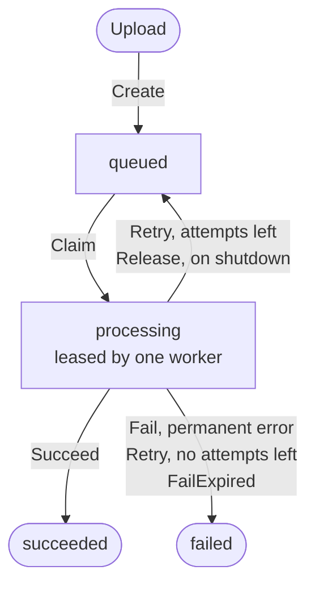

# Design notes

This document gives the details behind the [README](../README.md) for Part 2.

## API

| Method and path | Result |
|---|---|
| `POST /v1/recordings` | Queues the file in the multipart field `audio`. The `Idempotency-Key` header is optional. |
| `GET /v1/recordings/{id}` | Returns the job: status, attempts, last error, and the result when there is one. |
| `GET /healthz` | Returns `200` if the database answers, and `503` if it does not. |

| Upload status | Cause |
|---|---|
| `202` | The API made a new job. |
| `200` | A job with this `Idempotency-Key` exists. The API returns that job. |
| `400` | The request has no multipart field `audio`, the file is empty, or the `Idempotency-Key` is longer than 255 bytes. |
| `413` | The audio is larger than 25 MB, the OpenAI upload limit. |
| `415` | The file name does not end in `.flac`, `.m4a`, `.mp3`, `.mpeg`, `.mpga`, `.ogg`, `.wav` or `.webm`. |
| `422` | The `Idempotency-Key` exists, but the audio is different. |

## Pipeline



Each arrow is a `job.Store` method in `internal/job`. No other code changes the status. If a lease expires and the job has attempts left, the job stays `processing` until `Claim` gives it to another worker.

- **Postgres is the queue.** The jobs are already in Postgres, so the service needs no broker. A worker claims a job with `FOR UPDATE SKIP LOCKED` and gets a lease of 5 minutes. No row lock stays open after the claim. If the worker stops, another worker claims the job after the lease expires. This claim is a new attempt. If the stopped attempt was the last one, the service sets the job to `failed` within 5 minutes after the lease expires.
- **Fenced writes.** Every write about a job must name the current attempt number. A worker whose lease expired cannot overwrite the result of the next worker.
- **Retries with exponential backoff.** After a failed step, the worker puts the job back in the queue with a delay. The delay starts at 5 seconds and doubles after each failed attempt, to a maximum of 10 minutes. With the default `MAX_ATTEMPTS` of 5, the delays are 5, 10, 20 and 40 seconds, and the fifth failure sets the status to `failed`. A status below `500` that is not `2xx` fails the job at once, except `408` and `429`. An OpenAI `429` with the error code `insufficient_quota` also fails the job at once, because the account has no credit and a retry cannot succeed.
- **No second model call.** The worker saves the AI result before delivery. After a failed delivery, the retry sends only the delivery again.
- **Graceful shutdown.** On `SIGTERM` or `SIGINT`, the API stops accepting connections and the workers stop claiming. Open HTTP requests get 10 seconds. A running job gets 15 seconds to finish. If the job does not finish in that time, the worker cancels the job and puts it back in the queue. The service then adds 1 to `max_attempts` of that job, so the interrupted attempt does not use up an attempt.

## AI providers

| Provider | Models | Calls for each recording |
|---|---|---|
| OpenAI | A transcription model, then a report model with strict structured output | 2 |
| Gemini | One model with the audio inline and a JSON response schema | 1 |

`run` in `cmd/server/main.go` selects the provider and the destination with one `switch` each. A new provider is one package, one name in `internal/config` with a model setting and an allowlist for each model that the provider calls, one `case` in `run` and its entries in the `depguard` lists.

The service does not start if a model of the selected provider is not in its allowlist.

Both providers ask for a JSON schema, and `ai.ParseReport` checks the answer again. An unknown field, a `sentiment` other than `positive`, `neutral` or `negative`, or a bad date is an error, and the job retries.

Gemini accepts at most 100 MB of inline data in one request ([File input methods](https://ai.google.dev/gemini-api/docs/file-input-methods)). OpenAI accepts audio files of at most 25 MB ([Speech to text](https://platform.openai.com/docs/guides/speech-to-text)). Debrief sets the maximum upload to 25 MB, so the same limit works for both providers.

## Destinations

### Webhook

The service sends this JSON body, with the job ID in the `Idempotency-Key` header.

```json
{
  "id": "4dd8a666-06d8-400f-acf4-ebaba24cbbb5",
  "transcript": "Quick note after my visit at Bergmann Maschinenbau...",
  "report": {
    "customer": "Bergmann Maschinenbau",
    "contacts": ["Anna Weber, head of purchasing"],
    "summary": "Bergmann wants a quote for about forty X200 units.",
    "key_points": ["Price is the main concern"],
    "next_steps": ["Send the quote by Friday"],
    "follow_up_date": "2026-12-03",
    "sentiment": "positive",
    "products": ["X200 series"]
  }
}
```

### HubSpot

The service writes the report and the transcript as one HubSpot note on the timeline of the customer's company.

1. The service searches for a company whose `name` is equal to `customer`. HubSpot ignores case in this search.
2. If HubSpot finds no company, the service creates one with that name.
3. The service creates the HubSpot note with an association of the HubSpot default type `190`, "note to company".

If `customer` is empty, the HubSpot note has no association and shows on no timeline.

Limits:

- HubSpot has no idempotency key for HubSpot notes. If a response is lost, the retry can create a second HubSpot note.
- HubSpot says a new record can "take a few moments" to appear in search. A retry in that time can create a second company.
- The match uses the name only. A different spelling, such as "Bergmann GmbH", creates a new company.
- The service shortens a long transcript so that the HubSpot note body is at most 65,536 bytes. This is inside the HubSpot limit of 65,536 characters. If the report alone is too long, the service leaves out the transcript and shortens the report.

## Privacy

- Logs contain job IDs, statuses, durations and error text, never audio or transcripts. An HTTP error keeps the status code and the vendor's error code. The vendor error body can repeat request data, so the service writes it only to the `last_error_body` column, for operators. The service never logs the body, and the API never returns it. A network error keeps the cause but not the request URL, because a webhook URL can contain a secret. A validation error can quote one value from the model output, such as an invalid date.
- The service deletes the audio when the job succeeds. The audio of a `failed` job stays in the database.
